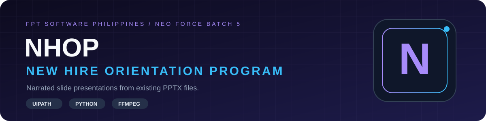
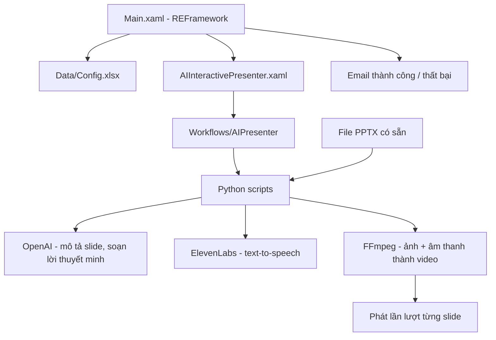

<div align="center">



# 🎙️ NHOP · New Hire Orientation Program

**Tự động hóa buổi định hướng nhân viên mới · UiPath · Python · FFmpeg · OpenAI · ElevenLabs**


**[Dự án làm gì?](#-dự-án-làm-gì) · [Chức năng chính](#-chức-năng-chính) · [Cách sử dụng](#-cách-sử-dụng) · [Tech stack](#-tech-stack) · [Kiến trúc](#-kiến-trúc) · [Chạy local](#-chạy-local) · [Tài liệu](#-tài-liệu)**

</div>

---

## 📖 Dự án làm gì?

NHOP là dự án tự động hóa buổi định hướng cho nhân viên mới. Robot **UiPath** nhận các file PowerPoint **có sẵn**, đọc nội dung từng slide, viết lời thuyết minh, chuyển lời thuyết minh thành giọng nói rồi phát lần lượt từng slide như một bài thuyết trình có tiếng. NHOP **không tạo slide**; slide là đầu vào do người dùng cung cấp.

Dự án do **NEO Force Batch 5 (OJT)** thực hiện tại **FPT Software Philippines**, nhằm giảm số lần phải thuyết trình trực tiếp lặp đi lặp lại.

| 📑 Đầu vào | 🧠 Lời thuyết minh | 🔊 Giọng nói | 🎬 Trình chiếu |
|---|---|---|---|
| File PPTX có sẵn trong thư mục input | OpenAI mô tả slide và soạn lời thuyết minh | ElevenLabs text-to-speech | FFmpeg ghép ảnh slide và âm thanh thành video, phát lần lượt |

Khi chạy xong, robot gửi email báo thành công hoặc thất bại. Video cuối cùng có thể phát lại sau đó.

## ✨ Chức năng chính

| Nhóm | Chức năng | Làm gì |
|---|---|---|
| 📑 Đầu vào | Nạp PPTX | `slides_from_pptx.py` đọc file PPTX trong `Data/AIPresenter/Input/pptx_file_here/` và tạo danh sách slide `Data/AIPresenter/Temp/slides_iterate.tsv` cùng ảnh slide |
| 📑 Đầu vào | Hàng đợi nhiều PPTX | File `pptx_run_order.xlsx` (hoặc `pptx_run_order_template.xlsx`) cho phép chạy nhiều PPTX theo thứ tự `run_order`, bật/tắt từng file bằng `enabled` |
| 🧠 Nội dung | Mô tả slide + soạn lời thuyết minh | `pipeline_extract_and_compose.py` gọi OpenAI (vision + GPT, prompt `presentation_master_prompt.txt`) và ghi `gpt_slide_content.txt` |
| 🔊 Giọng nói | Text-to-speech | `elevenlabs_tts.py` (qua workflow `ElevenLabsTTSWorkflow.xaml`) tạo file WAV cho từng slide |
| 🎬 Video | Ghép ảnh + âm thanh | `build_slide_video.py` dùng FFmpeg tạo đoạn MP4 từng slide (`slide_segment_{n}.mp4`) |
| ▶️ Trình chiếu | Phát lần lượt từng slide | `play_video_blocking.py` phát từng đoạn; nếu ghép video lỗi thì phát WAV thay thế (`play_response_audio.py`) |
| 🔁 Sau khi chạy | Xem lại | `AIPresenter_AfterPresentation.xaml` phát lại video cuối nếu có |
| 📧 Thông báo | Email kết quả | `SendEmailNotification.xaml` gửi email khi thành công hoặc thất bại |
| 🧱 Khung chạy | REFramework | `Main.xaml` khởi tạo cấu hình, dọn tiến trình, chạy `Process.xaml` rồi đóng ứng dụng |

## 🧰 Tech stack

| Công nghệ | Phiên bản | Vai trò |
|---|---|---|
| UiPath Studio / Robot | Không khai báo phiên bản trong README | Workflow XAML, REFramework |
| Python | 3 (khuyến nghị 3.11) | Script xử lý slide, gọi API, popup |
| FFmpeg | `ffmpeg`, `ffplay`, `ffprobe` | Tạo và phát video từng slide |
| OpenAI API | — | Hiểu nội dung slide và soạn lời thuyết minh |
| ElevenLabs API | — | Giọng nói (text-to-speech) |
| Microsoft PowerPoint · Excel | Cài trên máy chạy robot | Đọc PPTX, đọc cấu hình |
| Windows batch / PowerShell | — | Script hỗ trợ cài đặt |

### Thư viện Python

| Thư viện | Vai trò |
|---|---|
| `python-pptx` | Đọc slide từ file PPTX |
| `openpyxl` | Đọc/ghi file Excel |
| `Pillow` | Xử lý ảnh |
| `comtypes` · `pywin32` | Tự động hóa ứng dụng Windows |
| `tkinter` | Cửa sổ popup |

Danh sách đầy đủ nằm trong [requirements-aipresenter.txt](Data/AIPresenter/Scripts/requirements-aipresenter.txt).

## 🏗️ Kiến trúc



Luồng chạy:

1. `Main.xaml` nạp cấu hình từ `Data/Config.xlsx` và khởi động tiến trình (dựa trên Robotic Enterprise Framework của UiPath).
2. `AIInteractivePresenter.xaml` chạy các workflow AI presenter trong [`Workflows/AIPresenter`](Workflows/AIPresenter).
3. Script Python trong [`Data/AIPresenter/Scripts`](Data/AIPresenter/Scripts) tách slide từ PPTX, gọi OpenAI để mô tả từng slide và soạn lời thuyết minh, gọi ElevenLabs để tạo giọng nói.
4. FFmpeg ghép ảnh slide với âm thanh thành từng đoạn video, phát lần lượt. Có thể phát lại video cuối sau khi xong.
5. Gửi email thành công hoặc thất bại khi kết thúc.

## 🧩 Module

| Thư mục / file | Phạm vi |
|---|---|
| [`Main.xaml`](Main.xaml) · [`AIInteractivePresenter.xaml`](AIInteractivePresenter.xaml) | Điểm vào |
| [`Framework`](Framework) | Workflow REFramework: khởi tạo, xử lý, trạng thái, email, dọn dẹp |
| [`Workflows`](Workflows) | Workflow TTS ElevenLabs và các workflow `AIPresenter/*` |
| [`Data/Config.xlsx`](Data/Config.xlsx) | Cấu hình robot |
| [`Data/AIPresenter/Config`](Data/AIPresenter/Config) | Cài đặt AI, prompt, hướng dẫn thiết lập |
| [`Data/AIPresenter/Input`](Data/AIPresenter/Input) | File PPTX, prompt slide, bảng ánh xạ |
| [`Data/AIPresenter/Output`](Data/AIPresenter/Output) | Kết quả đầu ra |
| [`Data/AIPresenter/Scripts`](Data/AIPresenter/Scripts) | Script Python hỗ trợ |
| [`Documentation`](Documentation) | Tổng quan workflow, ứng dụng cần cài |
| [`Tests`](Tests) | Test case UiPath |
| [`check_and_install_dependencies.bat`](check_and_install_dependencies.bat) | Kiểm tra/cài dependency |

## 🚀 Chạy local

Chạy trên **Windows**. Các ứng dụng cần thiết được liệt kê trong [application_required_note.txt](Documentation/application_required_note.txt): UiPath Studio, Python 3 (khuyến nghị 3.11), FFmpeg, PowerPoint, Excel, cùng tài khoản OpenAI và ElevenLabs.

1. Chạy [`check_and_install_dependencies.bat`](check_and_install_dependencies.bat) để kiểm tra hoặc cài package Python và các dependency khác (script dùng winget và PowerShell).
2. Nếu cần, cài package Python thủ công:

   ```bash
   pip install -r Data/AIPresenter/Scripts/requirements-aipresenter.txt
   ```

   Xem thêm [PYTHON_SETUP.txt](Data/AIPresenter/Scripts/PYTHON_SETUP.txt) và [ffmpeg_install_guide.txt](Data/AIPresenter/Config/ffmpeg_install_guide.txt).
3. Điền key của bạn vào `Data/AIPresenter/Config/ai_settings.json` (xem [api_keys_guide.txt](Data/AIPresenter/Config/api_keys_guide.txt)). **Không commit key thật.**
4. Trong [`Data/Config.xlsx`](Data/Config.xlsx) (sheet Settings), đặt các key email thông báo.
5. Đặt các file PPTX cần trình chiếu vào `Data/AIPresenter/Input/pptx_file_here/`. Thứ tự chạy xem [pptx_run_order.README.txt](Data/AIPresenter/Input/pptx_run_order.README.txt).
6. Mở project bằng UiPath Studio và chạy `Main.xaml`.

### Cấu hình (chỉ tên — không dán secret)

| Nơi cấu hình | Khóa |
|---|---|
| `Data/AIPresenter/Config/ai_settings.json` | `openai_api_key`, `elevenlabs_api_key`, `elevenlabs_voice_id` |
| `Data/Config.xlsx` (sheet Settings) | `Email_Sender`, `Email_Recipient`, `Email_SenderPassword`, `Email_SmtpServer`, `Email_SmtpPort` |

Với Gmail, SMTP server là `smtp.gmail.com` và port là `587`.

## 🧭 Cách sử dụng

Hướng dẫn từ máy trống đến khi nghe được bài thuyết trình có tiếng. Mọi đường dẫn tính từ thư mục gốc project.

### 1. Yêu cầu trước khi bắt đầu

Theo [application_required_note.txt](Documentation/application_required_note.txt):

- **Windows** (project nhắm `targetFramework: Windows`).
- **UiPath Studio / Robot** (project tạo bằng Studio `26.0.x`, xem [project.json](project.json); `Main.xaml` là entry point duy nhất).
- **Python 3** (khuyến nghị 3.11), gồm `tkinter` (đi kèm Python trên Windows, không cài bằng pip).
- **FFmpeg**: `ffmpeg.exe`, `ffplay.exe`, `ffprobe.exe`.
- **Microsoft PowerPoint Desktop** (xuất slide thành ảnh PNG qua COM) và **Microsoft Excel** (đọc `Config.xlsx` và các file `.xlsx`).
- Tài khoản **OpenAI** (API key) và **ElevenLabs** (API key + voice ID), tạo theo [api_keys_guide.txt](Data/AIPresenter/Config/api_keys_guide.txt).
- Tùy chọn: winget + PowerShell, cần khi dùng file `.bat` bên dưới.

### 2. Cài dependency

1. Chạy [`check_and_install_dependencies.bat`](check_and_install_dependencies.bat) (thêm `--no-wait` nếu không muốn cửa sổ chờ Enter). Script lần lượt: kiểm tra winget → tìm/cài Python 3.11 (winget, hoặc tải từ python.org) → kiểm tra/cài pip → cài `requirements-aipresenter.txt` và kiểm tra import `python-pptx`, `openpyxl`, `Pillow`, `comtypes`, `pywin32`, `tkinter` → chuẩn bị FFmpeg.
2. FFmpeg: script cố gom bộ `ffmpeg/ffplay/ffprobe` vào `Data/AIPresenter/Tools/` (từ PATH, từ `ffmpeg_path` trong `ai_settings.json`, từ thư mục Downloads/Desktop/Documents, bằng winget `Gyan.FFmpeg`, hoặc tải zip). Nếu thất bại, tự đặt 3 file `.exe` vào `Data/AIPresenter/Tools/`; xem [ffmpeg_install_guide.txt](Data/AIPresenter/Config/ffmpeg_install_guide.txt).
3. Thủ công (nếu không dùng `.bat`): `py -m pip install -r Data\AIPresenter\Scripts\requirements-aipresenter.txt` (xem [PYTHON_SETUP.txt](Data/AIPresenter/Scripts/PYTHON_SETUP.txt)).
4. Kết thúc `.bat` báo `[SUCCESS]` nếu mọi thứ sẵn sàng, hoặc `[WARN] Completed with issues` (mã thoát 1) nếu còn lỗi.

### 3. Cấu hình

1. **Khóa AI**: sửa `Data/AIPresenter/Config/ai_settings.json`. Các khóa có trong file: `openai_api_key`, `elevenlabs_api_key`, `elevenlabs_voice_id` (bắt buộc), và `ffmpeg_path`, `openai_model`, `openai_vision_model` (mặc định `gpt-4o` theo PYTHON_SETUP), `whisper_model`, `audio_input_path`, `audio_output_path`, `slide_video_path`. Chỉ điền giá trị của riêng bạn; **không commit key thật**.
2. **Email thông báo**: trong `Data/Config.xlsx`, sheet Settings, đặt `Email_Sender`, `Email_Recipient`, `Email_SenderPassword`, `Email_SmtpServer`, `Email_SmtpPort` (Gmail: `smtp.gmail.com`, `587`).
3. **Prompt**: tùy chỉnh nếu muốn tại `Data/AIPresenter/Input/presentation_master_prompt.txt` (soạn lời thuyết minh) và `Data/AIPresenter/Config/system_prompt.txt`.
4. **UiPath Studio**: mở [project.json](project.json) bằng Studio, để Studio khôi phục các package (Excel, Mail, System, UIAutomation, Testing, WebAPI…). `Main.xaml` có hai argument tùy chọn `in_OrchestratorQueueName` và `in_OrchestratorQueueFolder` (chỉ dùng nếu chạy với Orchestrator queue; có thể để trống).
5. **Python trong workflow**: workflow gọi Python bằng `pyw` (không cửa sổ console). Nếu máy không có `pyw`, đổi biến tương ứng trong workflow sang `py` hoặc đường dẫn `pythonw.exe`. Robot phải chạy bằng cùng tài khoản Windows đã cài package pip.

### 4. Đặt đầu vào

1. Copy file `.pptx` cần thuyết trình vào `Data/AIPresenter/Input/pptx_file_here/`.
2. (Tùy chọn, nhiều file) mở `Data/AIPresenter/Input/pptx_run_order_template.xlsx` (hoặc lưu thành `pptx_run_order.xlsx`), giữ nguyên tiêu đề hàng 1: `run_order`, `pptx_path`, `enabled`. Số `run_order` nhỏ chạy trước; `pptx_path` là đường dẫn tuyệt đối hoặc tương đối (từ gốc project, `pptx_file_here`, hoặc `Input`); `enabled` nhận TRUE/FALSE (cũng 1/0, yes/no, on/off). Trùng đường dẫn chỉ xử lý một lần.
3. Thứ tự ưu tiên nguồn đầu vào do `slides_from_pptx.py` quyết định: PPTX được cấu hình → danh sách trong file run order → PPTX trong `pptx_file_here` → PPTX trong `Input` → `slides.xlsx`. Nếu file run order có nhưng không có dòng hợp lệ, workflow tự dò thư mục.

### 5. Chạy

1. Đóng PowerPoint/ứng dụng đang mở file đầu vào; mở project bằng UiPath Studio và chạy `Main.xaml` (nút **Run**).
2. Robot tự thực hiện theo thứ tự: `InitAllSettings` (đọc `Config.xlsx`) → `KillAllProcesses` → `InitAllApplications` → `Process.xaml` → `AIInteractivePresenter.xaml` → `AIPresenter_MainFlow.xaml`:
   1. `AIPresenter_InitAndPrepare`: chạy `slides_from_pptx.py` (tạo `slides_iterate.tsv` và ảnh slide), rồi `pipeline_extract_and_compose.py` (tạo `extracted_slides_raw.txt` và `gpt_slide_content.txt`).
   2. `AIPresenter_SlideIteration` cho từng slide: nếu có lời thuyết minh → ElevenLabs tạo WAV → đo độ dài WAV → FFmpeg ghép ảnh + WAV thành MP4 → phát đoạn video đó.
   3. `AIPresenter_AfterPresentation`: phát lại video cuối nếu có.
3. Cuối cùng robot đóng ứng dụng, dọn tiến trình và gửi email thành công/thất bại.

### 6. Kết quả mong đợi

- Bài thuyết trình **phát lần lượt từng slide kèm giọng đọc** trên máy chạy robot.
- File trung gian trong `Data/AIPresenter/Temp/`: `slides_iterate.tsv`, `extracted_slides_raw.txt`, `gpt_slide_content.txt`, `narration_{n}.wav`, `slide_segment_{n}.mp4`.
- `Data/AIPresenter/Output/` dùng cho audio phản hồi (mặc định `response.wav` theo [README](Data/AIPresenter/Output/README.txt)).
- Email báo kết quả tới `Email_Recipient`.

### 7. Xử lý sự cố

| Triệu chứng | Gợi ý (theo tài liệu trong repo) |
|---|---|
| `ffmpeg is not recognized` | Mở terminal mới sau khi sửa PATH; PATH phải trỏ tới thư mục `bin`; hoặc đặt 3 file `.exe` vào `Data/AIPresenter/Tools/`, hoặc điền `ffmpeg_path` trong `ai_settings.json` |
| `.bat` báo thiếu `tkinter` | Cài lại Python và bật “tcl/tk and IDLE” |
| `.bat` báo lỗi cài Python/pip/package | Đọc log pip in ra; chạy lại; hoặc cài Python thủ công theo PYTHON_SETUP.txt |
| Workflow không gọi được `pyw` | Đổi sang `py` hoặc đường dẫn `pythonw.exe` (PYTHON_SETUP.txt) |
| Không có lời thuyết minh / lỗi OpenAI | Kiểm tra `openai_api_key` trong `ai_settings.json` là key hợp lệ |
| Không có tiếng / lỗi ElevenLabs | Kiểm tra `elevenlabs_api_key` và `elevenlabs_voice_id` |
| Không xuất được ảnh slide | Cần PowerPoint Desktop cài trên máy (COM automation) |
| Windows hỏi “Is this file from a trusted source?” | Bỏ Mark of the Web bằng `Unblock-File` (script mở file đã tự gọi `Unblock-File`) |
| Chạy nhầm PPTX hoặc thứ tự sai | Kiểm tra `enabled`/`run_order` trong file run order (xem mục 4) |
| Không nhận email | Kiểm tra các khóa `Email_*` trong `Config.xlsx` |

> Chưa kiểm chứng từ repo: đường dẫn chính xác của video cuối cùng sau khi ghép (có script `concat_presentation_videos.py`), và các giá trị mặc định của `Config.xlsx` (file nhị phân).

## 📚 Tài liệu

| Tài liệu | Nội dung |
|---|---|
| [Workflow overview](Documentation/workflow_overview_en.md) | Tổng quan các workflow |
| [Ứng dụng cần cài](Documentation/application_required_note.txt) | Danh sách ứng dụng yêu cầu |
| [Hướng dẫn API key](Data/AIPresenter/Config/api_keys_guide.txt) | Cách lấy và đặt key |
| [Cài FFmpeg](Data/AIPresenter/Config/ffmpeg_install_guide.txt) | Hướng dẫn cài FFmpeg |
| [Thiết lập Python](Data/AIPresenter/Scripts/PYTHON_SETUP.txt) | Hướng dẫn thiết lập Python |
| [Thứ tự chạy PPTX](Data/AIPresenter/Input/pptx_run_order.README.txt) | Cách sắp xếp thứ tự file |

## 👥 Credits

NEO Force Batch 5, OJT, FPT Software Philippines. Chủ repo: [@fogit-hd](https://github.com/fogit-hd).

---

<div align="center">

**NHOP · NEO Force Batch 5 · FPT Software Philippines**

Licensed under the [MIT License](LICENSE). File license có dòng bản quyền của UiPath (từ template REFramework).

</div>
